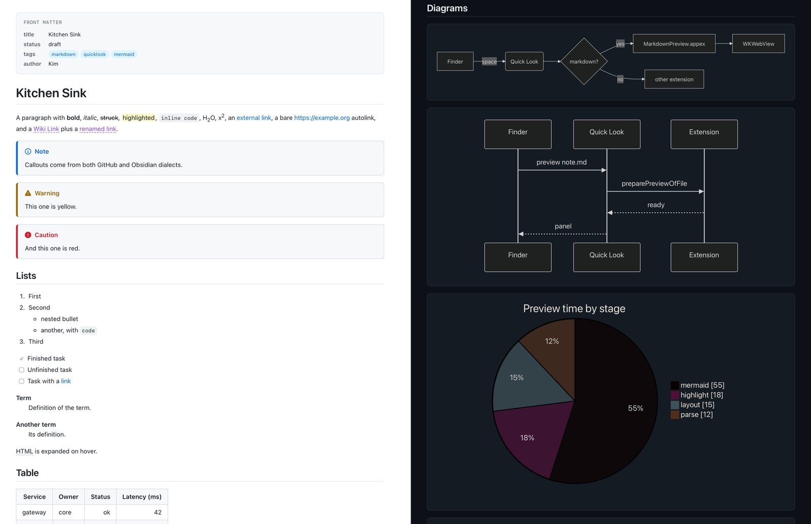
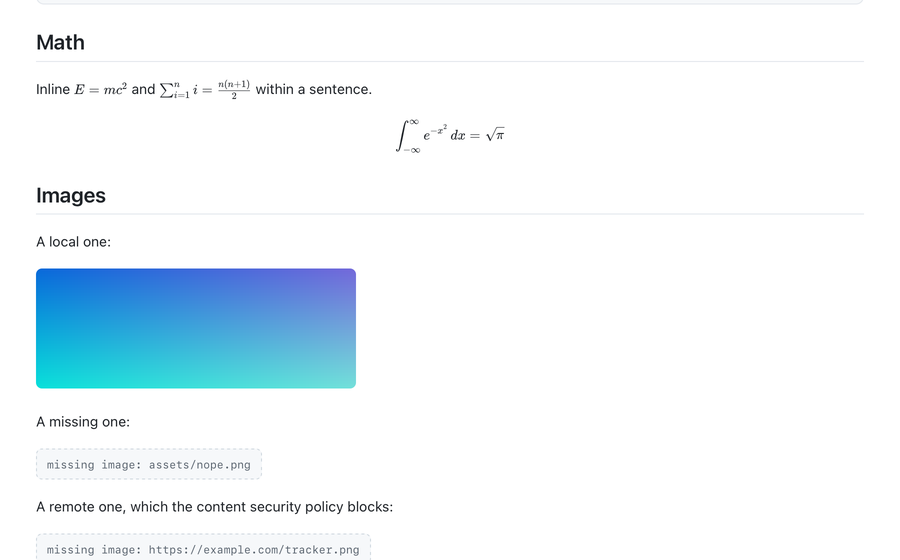

# mdql

A Quick Look extension for macOS. Press space on a `.md` file in Finder and
read it as a document instead of as source.



## What it renders

- CommonMark and GitHub-flavoured Markdown: tables, task lists, strikethrough,
  footnotes, definition lists, abbreviations, `==highlight==`, sub and sup
- Syntax highlighting for fenced code, with automatic language detection
- Mermaid diagrams: flowcharts, sequence, pie, gantt, state, ER, xychart
- LaTeX maths, inline and display
- GitHub and Obsidian callouts: `> [!NOTE]`, `> [!WARNING]`, `> [!CAUTION]` and
  the rest
- Obsidian wiki links, `[[Page]]` and `[[Page|alias]]`, and `![[image.png]]`
  embeds
- YAML front matter, shown as a header panel rather than as a wall of dashes
- Images sitting next to the file. Anything it cannot read is marked in place
- Light and dark, following the appearance of the panel it draws into
- A panel sized to your display, which then keeps whatever size you drag it to
- Finder thumbnails of the first page



## Install

Requires macOS 12 or later and Xcode.

```
git clone https://github.com/Kwickell/mdql.git
cd mdql
make install
```

That builds `MarkdownQuickLook.app`, copies it to `/Applications` and registers
both extensions. The app itself only hosts them and points at the Quick Look
settings pane. `make uninstall` removes it again.

There is no signed download. The build signs itself ad hoc, which is enough for
an app you compiled on the machine you run it on, and not enough for one you
downloaded. If you want a notarized build, you will need your own Developer ID.

The bundle identifier and signing identity are overridable:

```
MDQL_BUNDLE_ID=com.example.mdql MDQL_SIGN_IDENTITY="Developer ID Application: …" make install
```

If a preview does not appear, check that the extension is ticked under Quick
Look in System Settings, and that no other Markdown previewer is competing for
the same file type.

## How it works

Markdown is parsed in a sandboxed `WKWebView` by the usual engines, not by
anything written here: [markdown-it](https://github.com/markdown-it/markdown-it)
with seven plugins, [highlight.js](https://github.com/highlightjs/highlight.js),
[KaTeX](https://github.com/KaTeX/KaTeX) through
[markdown-it-texmath](https://github.com/goessner/markdown-it-texmath), and
[Mermaid](https://github.com/mermaid-js/mermaid). They are vendored into the app
bundle, so a build needs neither node nor the network. `THIRD_PARTY.md` lists
them with versions and licences.

The Swift side does no Markdown work. It decodes the file, fills in
`Resources/preview.html`, serves the bundle's assets to the web view over a
private `mdql:` URL scheme, and hands the view to Quick Look.
`Resources/render.js` then loads only the engines a given file actually needs,
so a plain note never pays for Mermaid's 2.5 MB.

```
Sources/MarkdownQuickLookCore/   decoding, page building, routing, the web renderer
Extensions/Preview/              QLPreviewingController
Extensions/Thumbnail/            QLThumbnailProvider
App/                             the bundle the extensions live in
Resources/                       preview.html, style.css, render.js, vendor/
CLI/                             mdql-render, writes a page to a folder
Probe/                           mdql-probe, renders and reports what the DOM contains
QLCheck/                         mdql-qlcheck, renders through the installed extension
```

## Privacy

A preview makes no network requests. The page's content security policy names
no `http` or `https` source of any kind, so a remote image or stylesheet in a
Markdown file is blocked rather than fetched, and every asset is served by the
extension itself.

Raw HTML in a Markdown file is parsed into an inert document and stripped of
`script`, `link`, `meta`, `base`, `iframe`, `object` and `embed`, along with
event handler attributes and `javascript:` URLs, before it is adopted into the
page. A `<link rel="dns-prefetch">` would otherwise leak a lookup that no
policy stops. Scripts are allowed by nonce alone, so a `.js` file sitting next
to the Markdown cannot be loaded even if something did inject a tag.

The extensions do hold `com.apple.security.network.client`, which looks wrong
for a previewer that never goes online. WebKit refuses to load anything at all
in a sandboxed app extension without it, including local content over a custom
scheme. The policy above is what keeps a preview offline; the entitlement is
the price of using a web view here.

## Working on it

```
make test        # unit tests, plus the rendering checks
make probe       # render fixtures/kitchen-sink.md and report what the DOM holds
make build       # build the app bundle
make vendor      # refresh the engines, needs node and the network
```

Because the Markdown pipeline is JavaScript, Swift tests cannot see whether
diagrams, maths or highlighting still work. `mdql-probe` renders a fixture
through the real web view and prints counts of what ended up in the DOM, and
`tools/check_rendering.py` asserts on those counts for three fixtures,
including a deliberately hostile one. Both run under `make test`.

To watch what the installed extensions are doing:

```
log stream --level debug --predicate 'subsystem == "io.github.kwickell.mdql"'
```

Render times and failures go there. Anything derived from the document itself,
such as file names, requested paths and page error messages, is logged as
private and shows as `<private>` unless you have enabled private data logging.
For content level debugging use `mdql-probe`, which prints everything.

## Licence

MIT, see `LICENSE`. The vendored engines keep their own licences, collected in
`Resources/vendor/licenses/` and listed in `THIRD_PARTY.md`.
