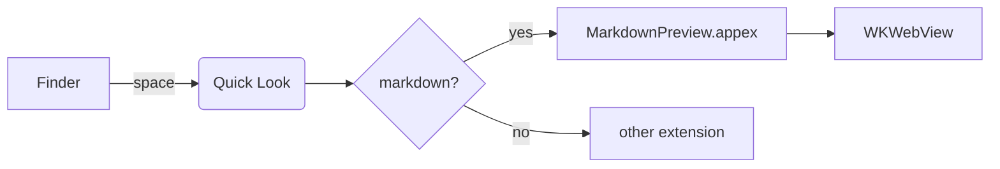
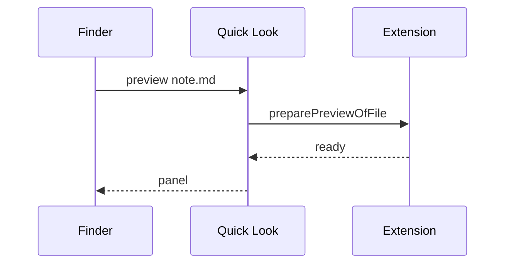
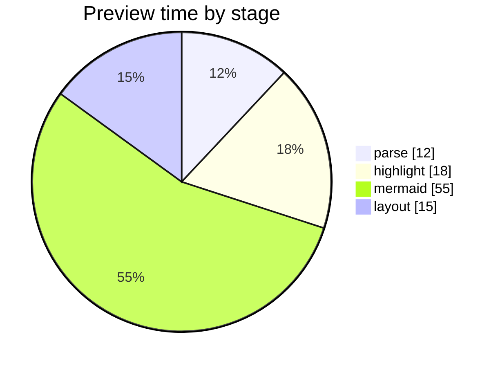
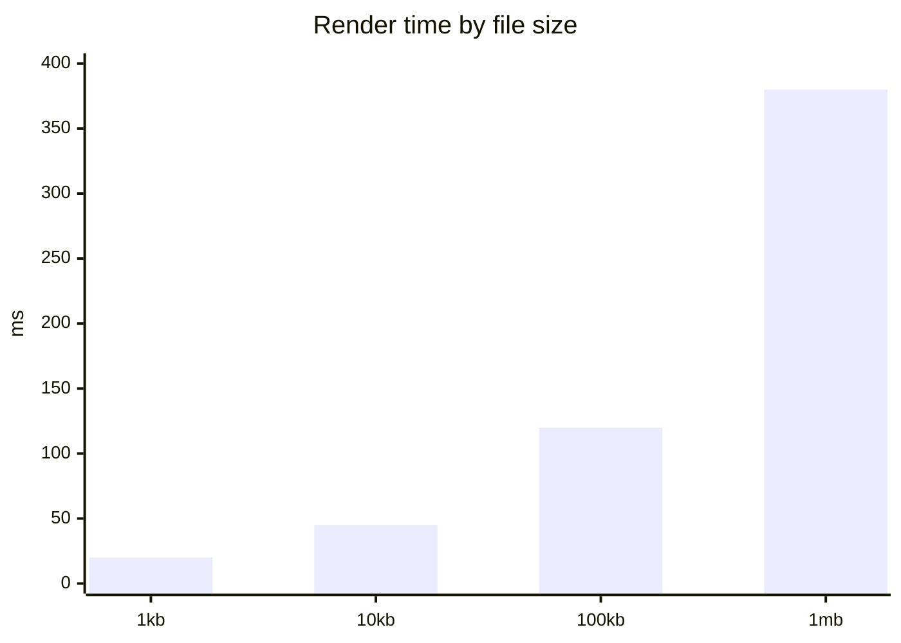

# Kitchen Sink

A paragraph with **bold**, *italic*, ~~struck~~, ==highlighted==, `inline code`,
H~2~O, x^2^, an [external link](https://example.com), a bare https://example.org
autolink, and a [[Wiki Link]] plus a [[Target Page|renamed link]].

> [!NOTE]
> Callouts come from both GitHub and Obsidian dialects.

> [!WARNING]
> This one is yellow.

> [!CAUTION]
> And this one is red.

## Lists

1. First
2. Second
   - nested bullet
   - another, with `code`
3. Third

- [x] Finished task
- [ ] Unfinished task
- [ ] Task with a [link](https://example.com)

Term
: Definition of the term.

Another term
: Its definition.

*[HTML]: HyperText Markup Language

HTML is expanded on hover.

## Table

| Service  | Owner | Status | Latency (ms) |
|----------|-------|-------:|-------------:|
| gateway  | core  |     ok |           42 |
| indexer  | data  |     ok |          118 |
| frontend | web   | broken |         1024 |

## Code

```swift
func preparePreviewOfFile(at url: URL) throws -> MarkdownDocument {
    try MarkdownDocument.load(contentsOf: url)   // decodes, then truncates
}
```

```python
def fib(n: int) -> int:
    return n if n < 2 else fib(n - 1) + fib(n - 2)
```

```json
{ "mermaid": true, "katex": true, "highlight": "auto" }
```

## Diagrams









## Math

Inline $E = mc^2$ and $\sum_{i=1}^{n} i = \frac{n(n+1)}{2}$ within a sentence.

$$
\int_{-\infty}^{\infty} e^{-x^2}\,dx = \sqrt{\pi}
$$

## Images

A local one:


A missing one:


A remote one, which the content security policy blocks:


## Footnotes

Quick Look hands the extension a sandboxed read of one file[^1], and nothing else[^2].

[^1]: Which is why sibling images sometimes cannot be read.
[^2]: No network, no other files.

---

*Rendered by MarkdownQuickLook.*
